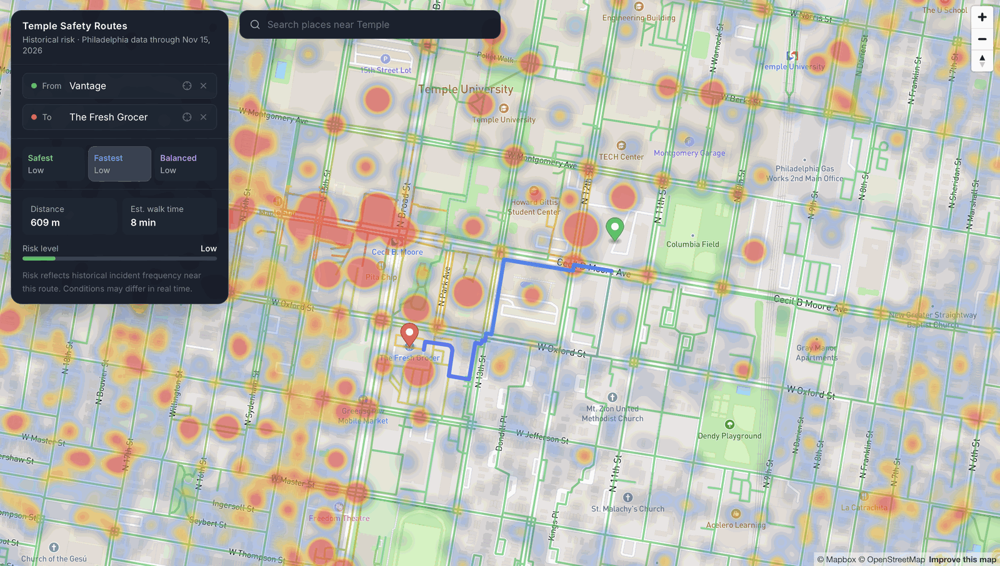
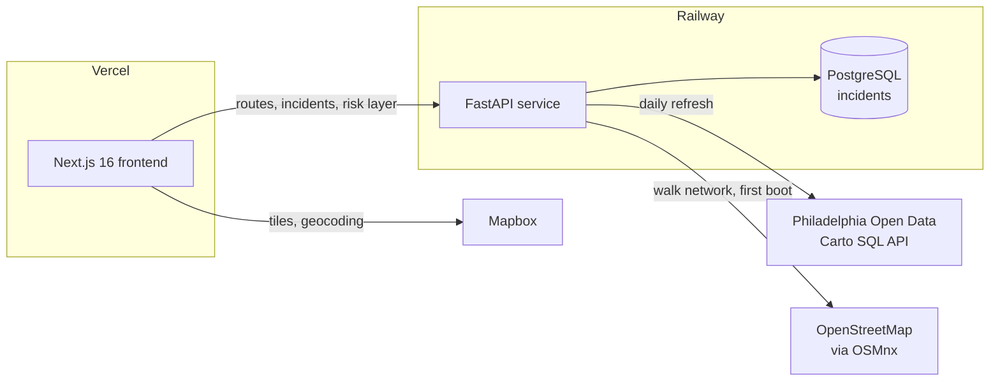

# TuMaps: Temple Campus Safety Routes

Walking directions around Temple University that weigh **historical incident data** alongside distance. Pick two points and TuMaps returns three routes (**Safest**, **Fastest** and **Balanced**) with distance, walk time and a risk score for each, over a live heatmap of reported incidents.

**Live demo:** [tu-maps.vercel.app](https://tu-maps.vercel.app)



---

## Features

- **Three routing strategies** computed in one request, with A* search on an OpenStreetMap walking network
- **Risk scoring per street segment** from about 3 years of Philadelphia police incident data, weighted by severity and recency
- **Incident heatmap** and colour-coded road risk overlay (Mapbox GL JS)
- **Search or pick on the map**: address search with Mapbox geocoding, and map clicks resolve to the nearest place or address
- **Self-refreshing data**: the API re-ingests new incidents daily and recomputes risk without redeploying
- **Resilient startup**: waits for the database, and starts in degraded mode with background retries if the map data download fails

## Architecture



The API keeps the road graph (about 11k nodes and 37k edges) in memory. Each edge carries a precomputed risk score, so a routing request is pure graph search with no database queries.

## How it works

### 1. Data pipeline

`backend/app/services/ingestion/`

1. **Fetch:** queries Philadelphia's `incidents_part1_part2` table for the last 3 years, limited to a bounding box that matches the routing graph (plus a margin for the risk radius). Results are **keyset-paginated** by `objectid` so every matching row is retrieved (about 70k).
2. **Merge:** an optional Temple University Police log source is deduplicated against city data (same incident if within 80 m and 2 days). Candidates are bucketed by date and only compared across sources, so this runs in linear time.
3. **Store:** the table is replaced in a single transaction, so readers never see a half-written dataset. If the city API fails, existing data is kept.
4. **Refresh:** a background task checks daily and re-runs the pipeline when the newest incident is more than 2 days old, then recomputes risk scores.

### 2. Risk model

`backend/app/services/risk.py`

For every street segment, TuMaps sums the incidents within **75 m** of its midpoint:

```
raw_risk(edge) = Σ severity(incident) × e^(−λ · age_in_days)      λ = 0.00385 (≈180-day half-life)
risk(edge)     = raw_risk(edge) / max(raw_risk)                     normalised to 0..1
```

| Incident type (UCR) | Severity |
|---|---|
| Homicide, rape | 1.0 |
| Robbery | 0.9 |
| Aggravated assault | 0.8 |
| Burglary | 0.5 |
| Auto theft | 0.4 |
| Theft | 0.35 |
| Arson | 0.3 |
| Other (Part II) | 0.2 |

Neighbour lookups use a **SciPy KD-tree** built once over all incidents, which avoids one spatial database query per edge (tens of thousands of queries).

### 3. Routing

`backend/app/services/routing.py`

All three routes run **A\*** on the same graph with different edge weights:

| Mode | Edge weight |
|---|---|
| Fastest | `travel_time` (length ÷ 1.25 m/s walking speed) |
| Balanced | `travel_time × (1 + 5 · risk)` |
| Safest | `length × (1 + 15 · risk)` |

The heuristic is straight-line distance (divided by walking speed for the time-based modes). It never overestimates the remaining cost, so A* still returns optimal paths. When the direct path is already low risk, all three modes agree and the UI says so.

### 4. Map payloads

`backend/app/routers/`

The heatmap needs location and weight, not every incident record. Incidents at the same point are merged into one feature whose weight is their summed severity. Mapbox heatmaps add weights per pixel, so the result renders identically. Coordinates are rounded to 5 decimals (about 1 m), unused properties are dropped, and responses are cached in memory and with `Cache-Control`.

| Endpoint | Before | After |
|---|---|---|
| `/api/incidents` | 8.2 MB (50,000 points) | 2.6 MB (~23,000 points) |
| `/api/segments/risk` | 3.3 MB | 2.7 MB |
| Total over the network (gzip) | 1.03 MB | 0.42 MB |

## Tech stack

| Layer | Tools |
|---|---|
| Frontend | Next.js 16, React 19, TypeScript, Tailwind CSS, Mapbox GL JS |
| Backend | FastAPI, SQLAlchemy 2 (async) + asyncpg, OSMnx, NetworkX, SciPy, NumPy |
| Data | Philadelphia Open Data (Carto SQL API), OpenStreetMap |
| Infrastructure | Vercel (frontend), Railway (API + PostgreSQL), Docker |

## Running locally

**Prerequisites:** Python 3.11, Node 20+, Docker, and a free [Mapbox](https://account.mapbox.com/) public token.

```bash
# 1. Database
docker compose up -d db

# 2. Backend (http://localhost:8000)
cd backend
python -m venv .venv && source .venv/bin/activate
pip install -r requirements.txt
cp .env.example .env
python -m scripts.ingest          # load incident data (about a minute)
uvicorn app.main:app --reload     # first start downloads the OSM graph (~30 s)

# 3. Frontend (http://localhost:3000)
cd ../frontend
npm install
cp .env.local.example .env.local  # add your Mapbox token
npm run dev
```

### Environment variables

| Variable | Where | Purpose |
|---|---|---|
| `DATABASE_URL` | backend | Postgres connection string (`postgres://` URLs are converted for asyncpg) |
| `CORS_ORIGINS` | backend | JSON list of allowed origins, e.g. `["http://localhost:3000"]` |
| `CORS_ORIGIN_REGEX` | backend | Optional pattern for preview deployments |
| `INCIDENT_REFRESH_HOURS` | backend | Hours between data freshness checks (`0` disables) |
| `INCIDENT_MAX_AGE_DAYS` | backend | Refresh when the newest incident is older than this |
| `PORT` | backend | Port to listen on (set by the host; defaults to 8000) |
| `NEXT_PUBLIC_API_URL` | frontend | Backend base URL |
| `NEXT_PUBLIC_MAPBOX_TOKEN` | frontend | Mapbox public token (restrict it to your domain) |

## API

| Method | Path | Description |
|---|---|---|
| `POST` | `/api/routes` | Body `{"origin": [lng, lat], "destination": [lng, lat]}`; returns `safest`, `fastest` and `balanced` routes |
| `GET` | `/api/incidents` | Weighted heatmap points plus `meta` (incident count and date range) |
| `GET` | `/api/segments/risk` | Street segments with normalised risk, for the road overlay |
| `GET` | `/health` | Service status and whether the road graph is loaded |

## Limitations and responsible use

- **Reported incidents are not the same as danger.** Police data reflects where incidents are reported and where officers patrol, not only where crime happens. Neighbourhoods with heavier enforcement can look riskier than they are.
- **Risk is shown as information, not a verdict.** The app reports historical frequency near a route. It does not label areas as safe or unsafe, and conditions change in real time.
- **No time of day yet.** A street's risk at 2 pm and 2 am is currently the same, even though the data has timestamps.
- **Coverage:** routing covers about a 2.2 km radius around Main Campus.

## Roadmap

- Time-of-day weighting of incident severity
- Colouring each route by its per-segment risk
- Vector tiles for the heatmap to shrink the first load further
- Better geocoding of Temple Police log entries (building names to coordinates)

More detail on the design decisions is in [`PROJECT_STATE.md`](PROJECT_STATE.md).
